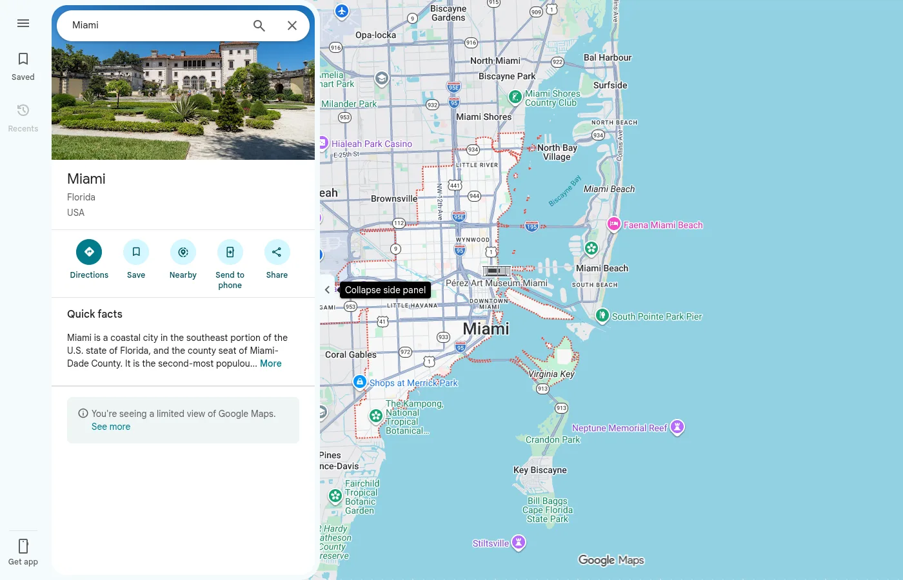
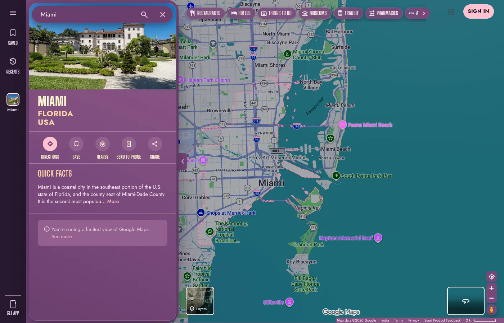
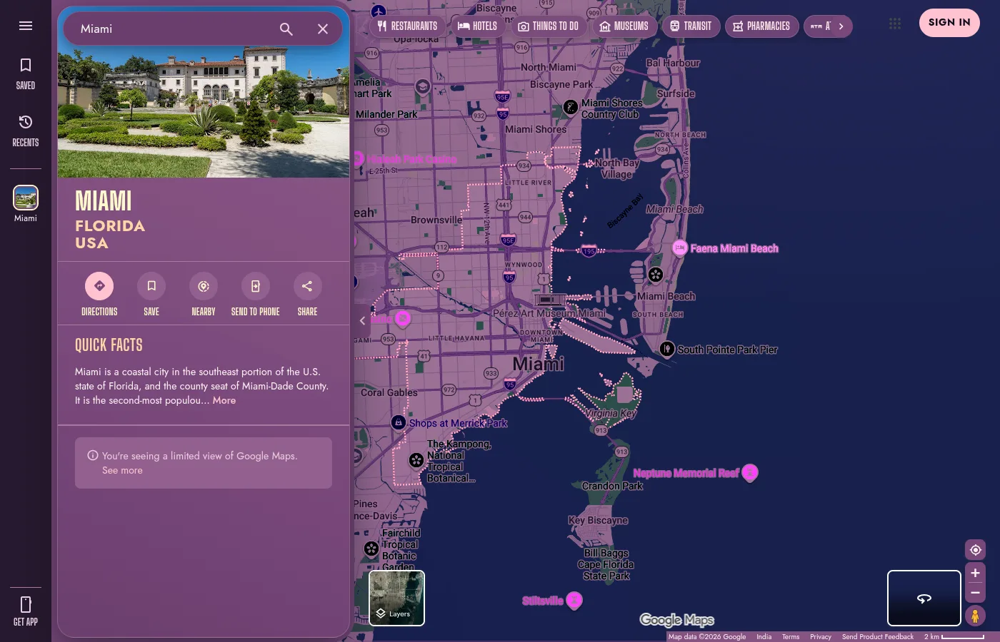
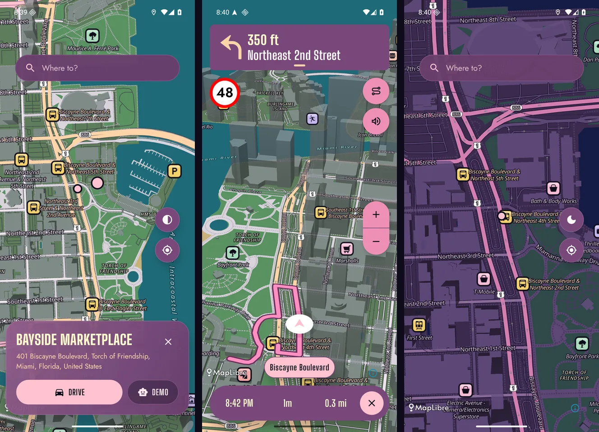

# Vice Maps

A sunset-pastel, game-map look for everyday maps: plum glass panels, condensed deco
headings, pink pill buttons, a teal sea and a dusk-purple night mode.

It comes in two parts:

- **[Chrome extension](extension/)** that restyles Google Maps in your browser.
- **[Android app](android/)** with its own map, search and turn-by-turn voice navigation,
  on the phone, with Android Auto screens for the car. It needs no accounts and no API keys.

| Before | After | Night |
|---|---|---|
|  |  |  |



## Chrome extension

1. Download or clone this repository.
2. Open `chrome://extensions` and turn on **Developer mode** (top right).
3. Click **Load unpacked** and pick the `extension` folder.
4. Open Google Maps.

The toolbar icon toggles the theme, switches the map grade (Day / Night / Off) and turns the
glass panels off. Satellite and Street View are left alone. Details: [extension/README.md](extension/README.md).

## Android app

You build it yourself and install it on your own phone; there is no Play Store listing.
You need JDK 21 and the Android SDK (platform 36).

```bash
cd android
./gradlew :app:assembleRelease -PphoneOnly   # ~25 MB, arm64 phones
adb install -r app/build/outputs/apk/release/app-release.apk
```

A sideloaded APK runs on the phone. Android Auto only shows Car App Library apps from a
trusted source such as Google Play's internal testing, or in the Desktop Head Unit on your
computer. Full steps, settings and how it works: [android/README.md](android/README.md).

## Fair use of the free servers

The app uses free public services: OpenFreeMap for map tiles, the FOSSGIS Valhalla server
for routing and Komoot's Photon server for search. They are run by volunteers and companies
for the community and ask for fair use. That is fine for one person driving around. If you
ship this to more people, run your own Valhalla and Photon and point the app at them
(see [android/README.md](android/README.md#use-your-own-servers)).

## Credits and license

MIT, see [LICENSE](LICENSE). Fonts, icons, the base map style and services are credited in
[THIRD_PARTY_NOTICES.md](THIRD_PARTY_NOTICES.md). Map data © OpenStreetMap contributors.

Inspired by the look of fan-made game maps. Vice Maps is not affiliated with Google,
Rockstar Games or MapGenie.

Built with Claude Code (Claude Opus 5.5).
