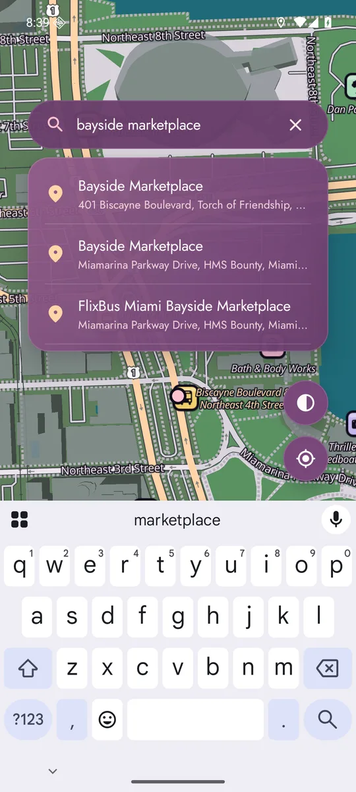
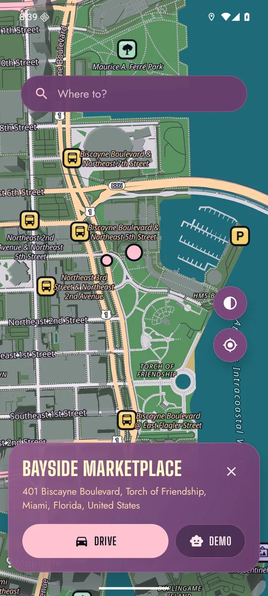
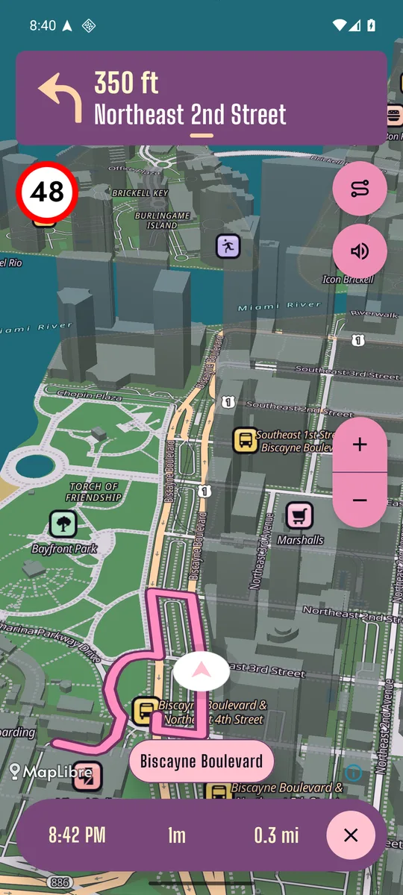
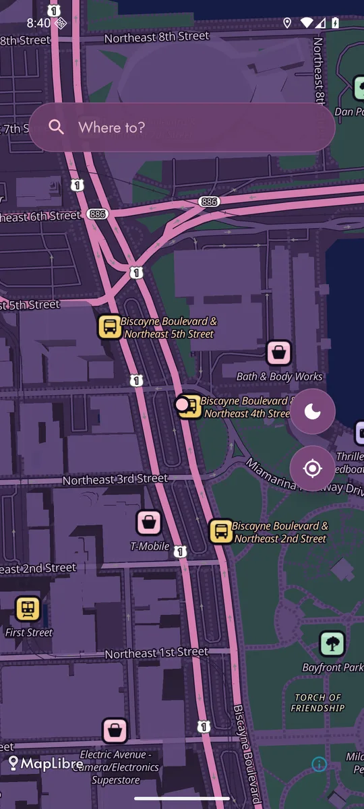

# Vice Maps for Android and Android Auto

A navigation app with the Vice Maps look, on the phone and on the car's screen. It needs no
accounts and no API keys.

| Search | Destination | Navigation | Night |
|---|---|---|---|
|  |  |  |  |

## What it does

- Search places and addresses, or long-press the map to drop a pin.
- Turn-by-turn navigation with voice prompts, speed limits and rerouting when you
  go off route.
- **Demo** drives the route for you with a simulated location, which is handy for trying it at your desk.
- Day, Night or Auto (follows the system) map look.
- Android Auto: the same map, navigation and search on the car's screen, with the turn card
  in plum.

## The stack

| Part | What | Key needed? |
|---|---|---|
| Map rendering | MapLibre Native, via maplibre-compose | No |
| Map tiles, fonts | OpenFreeMap (OpenStreetMap data, OpenMapTiles schema) | No |
| Map style | `app/src/main/assets/vice-day.json`, `vice-night.json`, generated from OpenFreeMap's Liberty style | No |
| Map icons | `app/src/main/assets/sprites/`, category badges drawn from Maki icons | No |
| Routing | Valhalla (public FOSSGIS server by default) | No |
| Navigation logic | Ferrostar | No |
| Search | Photon (public Komoot server by default) | No |
| Car screen | AndroidX Car App Library, navigation category | No |

## Build and install

You need JDK 21 and the Android SDK with platform 36 (Android Studio includes both). Point
Gradle at the SDK with `ANDROID_HOME` or a `local.properties` file (`sdk.dir=...`).

```bash
./gradlew :app:assembleRelease -PphoneOnly
adb install -r app/build/outputs/apk/release/app-release.apk
```

`-PphoneOnly` leaves out the x86_64 native libraries the emulator needs, so the APK drops to
about 25 MB. Leave the flag off to build for both phones and the emulator.

Release builds are shrunk with R8. They are signed with your own key when
`android/keystore.properties` exists, and with the local debug key otherwise. The debug key
is fine for your own phone:

```properties
# android/keystore.properties (git-ignored)
storeFile=/path/to/vice-maps.jks
storePassword=...
keyAlias=vice-maps
keyPassword=...
```

Installing without a computer: copy the APK to the phone, open it, and allow installs from
that app when Android asks. Play Protect may warn about an unknown app; that is expected for
an app that isn't on the Play Store. A sideloaded install works on the phone, but not on the
car screen (see below).

## Show it in Android Auto

Android Auto's **Unknown sources** developer setting does **not** cover apps built with the
Car App Library, so a sideloaded APK won't appear on a real car's screen. Google's
[testing guide](https://developer.android.com/training/cars/testing#test-real-vehicles)
lists two ways to run it:

- **On your computer:** the
  [Desktop Head Unit](https://developer.android.com/training/cars/testing/dhu) (DHU), an
  Android Auto simulator. Install the app with `adb`, enable Android Auto's developer
  settings (tap **Version** about ten times), start the head unit server, and run `desktop-head-unit`.
- **In a real car:** install the app from a trusted source. Upload the release build to
  Google Play's Internal App Sharing or an internal testing track. That needs a Play
  developer account, but no public listing.

Release builds only talk to the official Android Auto and Android Automotive hosts. Debug
builds accept any host.

The car screens are built on Google's navigation templates but haven't been tested on a
real car yet. Reports are welcome.

## Use your own servers

The public Valhalla and Photon servers are for fair use. To use your own, or to set a
User-Agent that identifies you, pass Gradle properties (on the command line or in
`~/.gradle/gradle.properties`):

| Property | Default |
|---|---|
| `viceMaps.valhallaUrl` | `https://valhalla1.openstreetmap.de/route` |
| `viceMaps.photonUrl` | `https://photon.komoot.io/api/` |
| `viceMaps.userAgent` | `ViceMaps/<version> (Android; open source)` |

```bash
./gradlew :app:assembleRelease -PviceMaps.valhallaUrl=https://valhalla.example.com/route
```

## Changing the look

The map style and icons are generated, not hand-edited:

```bash
python3 tools/build_styles.py     # colours, fonts, label styles -> assets/vice-*.json
python3 tools/build_sprites.py    # category badges -> assets/sprites/vice*.{png,json}
```

- `tools/build_styles.py` recolours every layer of `tools/liberty.json` by its role (water,
  park, motorway, label and so on). Change `PALETTES` to change the colours.
- `tools/build_sprites.py` draws a rounded badge per point of interest from the Maki icons in
  `tools/vendor/maki` and merges it with the road shields from `tools/vendor/ofm`. It renders
  with headless Chromium through Playwright, so it needs Node and Playwright:

  ```bash
  PLAYWRIGHT_NODE_PATH=/path/to/node_modules CHROME=/path/to/chrome python3 tools/build_sprites.py
  ```

  Change `GROUPS` to recolour a category, or `MAKI_ALIASES` to pick a different icon.

The app's UI colours and fonts live in `app/src/main/java/dev/vicemaps/ui/theme/ViceTheme.kt`.

## Code map

| File | What it does |
|---|---|
| `AppModule.kt` | Shared singletons: Ferrostar core, location, HTTP client, search |
| `ViceNavigationViewModel.kt` | Search, selected place, starting and stopping navigation |
| `ui/MapScreen.kt` | Phone UI: map, search, destination sheet, navigation view |
| `ui/ViceNavigationTheme.kt` | Turn banner, trip bar, puck and route line styling |
| `car/ViceCarAppService.kt` | Android Auto entry point, "navigate to" intents |
| `car/ViceCarNavigationScreen.kt` | Car map and navigation template |
| `car/ViceCarSearchScreen.kt` | Car search |
| `search/PhotonSearch.kt` | Photon geocoding client |
| `Settings.kt` | Units and map look, saved on the device |

## Known limits

- Routing and search depend on free public servers; they can be slow or rate limited.
- There are no offline maps yet.
- Units default to miles in the US, UK, Liberia and Myanmar, and kilometres elsewhere.
  There is no settings screen yet.
