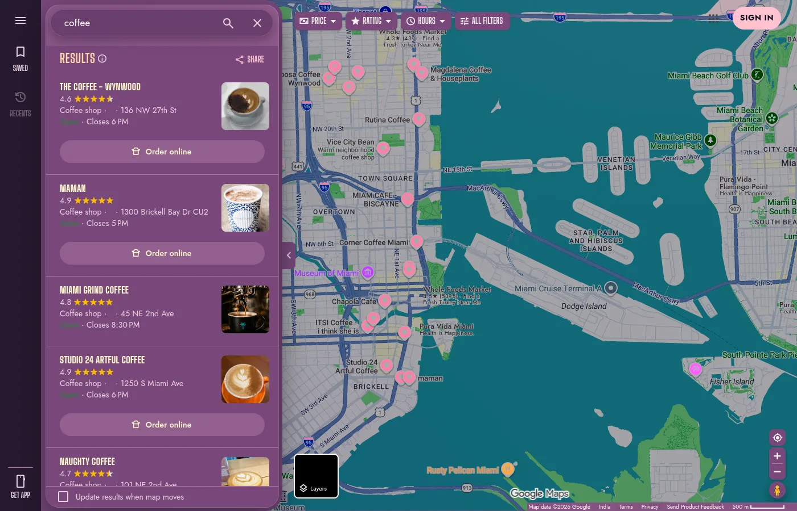
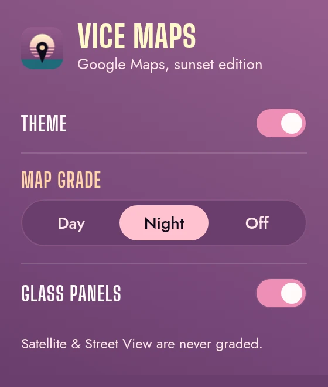

# Vice Maps for Chrome

Restyles Google Maps with the Vice Maps look: plum glass panels, condensed deco headings,
pink pill buttons and a colour-graded map (teal sea, slate city and palm-green parks by day,
indigo and dusk purple by night).

## Install

1. Open `chrome://extensions` and turn on **Developer mode**.
2. **Load unpacked** and pick this `extension` folder.
3. Open Google Maps.

It works in other Chromium browsers (Edge, Brave, Arc) the same way.

The popup has three settings, saved with Chrome sync:

| Setting | What it does |
|---|---|
| Theme | Turns the whole restyle on or off |
| Map | Day, Night or Off for the map colour grade |
| Glass | Translucent plum panels, or solid ones |

## How it works

- **Colours.** Google Maps keeps its colours in hashed CSS custom properties (`--tXXXX`) on
  `:root`, and the names change between releases. `src/content.js` reads every colour token
  at runtime and maps it onto the palette by its value (lightness, hue, saturation), so it
  keeps working when Google renames them.
- **Shapes and fonts.** `content.js` tags landmarks (side panel, search box, chips,
  controls, map canvas) with stable `vice-*` classes, and `src/vice.css` styles those.
- **The map.** Google draws the map into a canvas, so it can't be restyled with CSS. Instead
  an SVG `feColorMatrix` filter grades the canvas colours. Satellite and Street View are
  detected from the URL and never graded.
- **Fonts.** Big Shoulders Display and Jost, bundled under the SIL Open Font License.

Only `google.com/maps` and `maps.google.com` are matched. Add your country's Google domain to
`matches` in `manifest.json` (both places) if you use one, then reload the extension.

Google can change its page at any time, so some panels may lose their styling until the
selectors are updated. Issues and pull requests are welcome.
